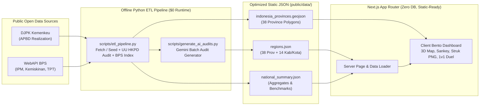

# Technical Specification (TECH_SPEC)
## Kawal APBD — Rapor Kesehatan Uang Rakyat

**Version:** 1.0.0  
**Stack:** Next.js 16 (App Router), TypeScript, Tailwind CSS v4, Shadcn UI, MapLibre GL JS, Recharts, GSAP, Framer Motion, `html-to-image`, Lucide React, Python 3.13.

---

## 1. Zero-Cost ($0) Static System Architecture



### Key Architectural Principles
1. **Zero Paid Runtime Dependencies:** No database server, no Mapbox paid token (uses custom zero-token MapLibre GL JS style specification with local GeoJSON polygons + cartographic graticule/ocean backdrop), and no live LLM calls per user visit (AI audit insights are pre-computed in batch and shipped inside `regions.json`).
2. **Server-First Data Loading:** `src/app/page.tsx` loads `regions.json` and `national_summary.json` directly on the server (using `fs/promises`) and passes typed props down to interactive client components, keeping initial TTFB fast and SEO-rich.
3. **Graceful Offline & Live ETL Modes:** `scripts/etl_pipeline.py` supports `--mode live` (attempts DJPK & BPS API fetch with strict timeout & schema validation) and `--mode seed` (default deterministic build using curated, realistic 2024/2025 fiscal & BPS figures for all 38 Indonesian provinces + 14 major Kabupaten/Kota).

---

## 2. Directory Structure

```text
kawal-apbd/
├── docs/
│   ├── PRD.md
│   ├── TECH_SPEC.md
│   ├── EXECUTION_PLAN.md
│   └── PROGRESS.md
├── design-system/
│   └── kawal-apbd/
│       ├── MASTER.md
│       ├── tokens.css
│       └── tokens.json
├── scripts/
│   ├── requirements.txt
│   ├── etl_pipeline.py
│   └── generate_ai_audits.py
├── public/
│   └── data/
│       ├── regions.json
│       ├── national_summary.json
│       └── indonesia_provinces.geojson
├── src/
│   ├── app/
│   │   ├── layout.tsx
│   │   ├── globals.css
│   │   └── page.tsx
│   ├── components/
│   │   ├── ui/                    # Shadcn UI primitives (button, card, badge, input, select, tabs, table, dialog)
│   │   ├── layout/
│   │   │   ├── Navbar.tsx
│   │   │   ├── Footer.tsx
│   │   │   └── ThemeProvider.tsx
│   │   ├── hero/
│   │   │   └── ScrollytellingHero.tsx
│   │   ├── dashboard/
│   │   │   ├── KawalApbdApp.tsx   # Main client orchestrator holding selected region & tab state
│   │   │   ├── KpiBentoStrip.tsx
│   │   │   ├── RegionFilterBar.tsx
│   │   │   ├── HkpdComplianceCard.tsx
│   │   │   ├── AiAuditorCard.tsx
│   │   │   ├── SankeyMoneyFlow.tsx
│   │   │   ├── BpsCorrelationChart.tsx
│   │   │   └── RegionLeaderboardTable.tsx
│   │   ├── map/
│   │   │   └── SpatialMap3D.tsx   # MapLibre GL JS 3D extruded map + accessible fallback
│   │   ├── receipt/
│   │   │   └── StrukBelanjaPajak.tsx  # Thermal receipt + html-to-image PNG download
│   │   └── duel/
│   │       └── AduEfisiensiDaerah.tsx # 1v1 Head-to-Head comparison arena
│   ├── lib/
│   │   ├── utils.ts               # cn(), Rupiah & percentage formatters
│   │   ├── audit-engine.ts        # Shared TypeScript mirror of UU HKPD + Receipt breakdown calculator
│   │   └── data-loader.ts         # Server-side JSON loader
│   └── types/
│       └── apbd.ts                # All TypeScript interfaces
├── package.json
├── next.config.ts
└── tsconfig.json
```

---

## 3. Exact TypeScript Interfaces (`src/types/apbd.ts`)

```typescript
export type RegionLevel = "provinsi" | "kabupaten" | "kota";

export type IslandCluster =
  | "Sumatera"
  | "Jawa"
  | "Kalimantan"
  | "Sulawesi"
  | "Bali & Nusa Tenggara"
  | "Maluku & Papua";

export type HkpdGrade = "hijau" | "kuning" | "merah";

export type EffectivenessArchetype =
  | "Efisien & Pro-Publik"
  | "Anggaran Besar, Dampak Minim"
  | "Keterbatasan Fiskal namun Inovatif"
  | "Birokrasi Gemuk, Layanan Tertekan"
  | "Transisi Reformasi Fiskal";

export interface BudgetRevenue {
  total_pendapatan_miliar: number;       // Billion IDR
  pad_miliar: number;                    // Pendapatan Asli Daerah
  tkd_miliar: number;                    // Dana Transfer ke Daerah (Pusat)
  lain_lain_miliar: number;              // Lain-lain Pendapatan Daerah Sah
  pad_ratio_pct: number;                 // Kemandirian Fiskal (%)
  tkd_ratio_pct: number;                 // Ketergantungan Transfer Pusat (%)
}

export interface BudgetExpenditure {
  total_belanja_miliar: number;          // Billion IDR
  pegawai_miliar: number;
  barang_jasa_miliar: number;
  modal_infrastruktur_miliar: number;
  pendidikan_miliar: number;             // Functional allocation (can overlap economic posts; tracked separately for UU HKPD + receipt)
  kesehatan_miliar: number;
  lainnya_miliar: number;
  // Percentages of total_belanja_miliar
  pegawai_pct: number;
  barang_jasa_pct: number;
  infrastruktur_pct: number;             // Belanja Infrastruktur Pelayanan Publik (UU HKPD definition)
  pendidikan_pct: number;                // Mandatory Spending Pendidikan
  kesehatan_pct: number;
  lainnya_pct: number;
  // Derived civic split (sums to 100%)
  birokrasi_pct: number;
  publik_pct: number;
}

export interface HkpdAudit {
  score: number;                         // 0 - 100
  grade: HkpdGrade;                      // "hijau" | "kuning" | "merah"
  grade_label: string;                   // "Rapor Hijau" | "Rapor Kuning" | "Rapor Merah"
  pegawai_compliant: boolean;            // pegawai_pct <= 30
  infrastruktur_compliant: boolean;      // infrastruktur_pct >= 40
  pendidikan_compliant: boolean;         // pendidikan_pct >= 20
  pegawai_points: number;                // max 40
  infrastruktur_points: number;          // max 35
  pendidikan_points: number;             // max 25
}

export interface BpsIndicators {
  year: number;
  population: number;                    // Jiwa
  ipm: number;                           // Indeks Pembangunan Manusia (0-100)
  poverty_rate_pct: number;              // Tingkat Kemiskinan (%)
  tpt_pct: number;                       // Tingkat Pengangguran Terbuka (%)
  apbd_per_capita_idr: number;           // Total Belanja / Population in IDR
}

export interface EffectivenessIndex {
  social_outcome_score: number;          // 0 - 100
  effectiveness_score: number;           // 0 - 100
  archetype: EffectivenessArchetype;
  rank_national: number;
}

export interface AiAuditInsight {
  fiscal_finding: string;                // Sharp plain-Indonesian insight on budget ratios
  social_correlation: string;            // Cross-analysis of APBD vs BPS IPM/Poverty
  policy_recommendation: string;         // Actionable civic/policy takeaway
  generated_by: string;                  // "Kawal APBD Auditor v1 (Pre-computed)" or "Gemini 2.5 Flash (Batch)"
  audited_at: string;                    // ISO date
}

export interface RegionRecord {
  id: string;                            // e.g. "prov-31" or "kota-3578"
  bps_code: string;                      // Official Kemendagri/BPS code e.g. "31", "3578"
  name: string;                          // e.g. "DKI Jakarta", "Kota Surabaya"
  province_id: string;                   // Parent province ID (same as id for provinces)
  level: RegionLevel;
  island: IslandCluster;
  fiscal_year: number;
  centroid: [number, number];            // [lng, lat]
  revenue: BudgetRevenue;
  expenditure: BudgetExpenditure;
  hkpd: HkpdAudit;
  bps: BpsIndicators;
  effectiveness: EffectivenessIndex;
  ai_audit: AiAuditInsight;
}

export interface NationalSummary {
  fiscal_year: number;
  generated_at: string;
  data_sources: string[];
  total_regions: number;
  total_provinces: number;
  total_kab_kota_samples: number;
  total_apbd_triliun: number;
  avg_hkpd_score: number;
  avg_pegawai_pct: number;
  avg_infrastruktur_pct: number;
  avg_pendidikan_pct: number;
  avg_birokrasi_pct: number;
  avg_publik_pct: number;
  avg_ipm: number;
  avg_poverty_pct: number;
  median_apbd_per_capita_idr: number;
  grade_distribution: {
    hijau: number;
    kuning: number;
    merah: number;
  };
  top_efficient_ids: string[];
  needs_attention_ids: string[];
}
```

---

## 4. Python ETL & Batch AI Auditor Specifications

### 4.1. `scripts/etl_pipeline.py`
- **Dependencies:** Pure Python 3 standard library (`json`, `math`, `urllib.request`, `pathlib`, `argparse`, `datetime`) with optional `pandas` & `requests` acceleration if installed, guaranteeing 100% deterministic execution on any machine.
- **Outputs:**
  1. `public/data/regions.json` — All **38 Provinces** (including the 4 new Papua provinces: Papua Selatan, Papua Tengah, Papua Pegunungan, Papua Barat Daya) + **14 major Kabupaten/Kota** across Indonesia (52 regions total).
  2. `public/data/national_summary.json` — Pre-aggregated KPIs, grade counts, national medians, and top/bottom rankings.
  3. `public/data/indonesia_provinces.geojson` — Valid GeoJSON FeatureCollection with 38 simplified, non-overlapping provincial polygon geometries covering the entire Indonesian archipelago (Sumatera to Papua) with matching `id`, `bps_code`, `name`, `total_apbd_triliun`, `hkpd_score`, `grade`, and `effectiveness_score` properties ready for MapLibre GL JS 3D extrusion.
- **Validation Gate:** Before writing JSON, the script asserts:
  - Exactly 38 provinces exist (`level == "provinsi"`).
  - Every `hkpd.score` is within `[0, 100]`.
  - Every province `id` in `regions.json` matches a GeoJSON feature in `indonesia_provinces.geojson`.
  - No `NaN`, `null`, or negative budget values.

### 4.2. `scripts/generate_ai_audits.py`
- Production-ready batch script reading `public/data/regions.json`, calling Gemini API (`gemini-2.5-flash`) via `GEMINI_API_KEY` environment variable (never hardcoded!), enforcing structured JSON output with 3 Bahasa Indonesia audit insights per region, and saving back to `public/data/regions.json`.
- Supports `--dry-run` mode to preview prompts without making external API calls.

---

## 5. Non-Functional & Quality Requirements

- **Accessibility (WCAG AA):** Contrast $\ge 4.5:1$ in Light & Dark modes, keyboard-operable tabs/selects/filters, visible focus rings, `aria-label` on icon buttons, `prefers-reduced-motion` honored in GSAP and Framer Motion, accessible data tables paired with Sankey & 3D Map.
- **Responsive Breakpoints:** Verified cleanly across `375px` (mobile), `768px` (tablet), `1024px` (laptop), and `1440px` (desktop) with zero horizontal scroll overflow.
- **Verification Gates:**
  - `python scripts/etl_pipeline.py --verify` exits `0`
  - `npx tsc --noEmit` exits `0`
  - `npm run lint` exits `0`
  - `npm run build` exits `0`
